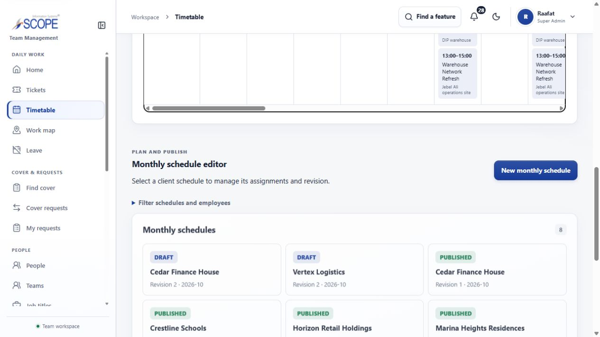
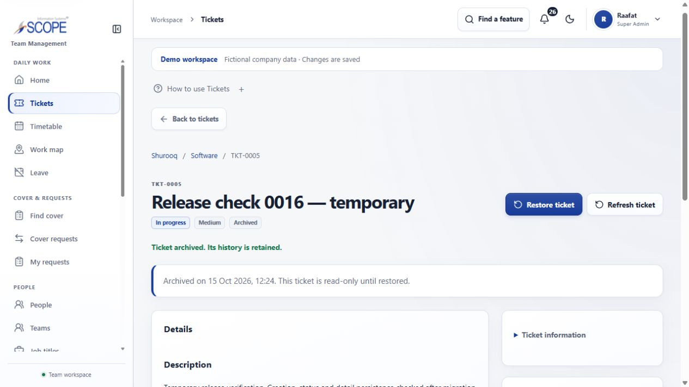

# Gap-fix production recovery and verification — 15 October 2026

**Status: production migration complete; live application and all three roles verified.** The owner authorized applying `0016`, deploying latest `main`, preserving existing data/permissions, and investigating the reported table and ticket failures. The source application is `2d7ff5a9d2315827ce3447daff22bfa6fb9d31b7` (implementation `3599844` plus delivery documentation). All 466 frozen application/test/configuration inputs still match. This release changes production schema to match that already-deployed application; no application-code repair was needed after migration.

The signed-in dashboard initially showed “Something went wrong.” Production had 16 migration rows and lacked `schedule_assignments.omitted_at`, which the deployed schedule/report queries require. After the migration and a full reload, the dashboard and timetable recovered. Ticket creation, changes and persistence were then exercised successfully; no separate ticket defect was established. Earlier anonymous-only checks did not certify signed-in page operation.

## Production transition and data preservation

The existing Company database remains `scopeis_company_demo`, Neon project `morning-flower-68935124`, through the unchanged application endpoint `ep-steep-poetry-avl3re9t`. Canonical migration `0016_schedule_assignment_omission` has SHA-256 `5774d471fc1ac8007dfce84726be07f39fa0fe7925e20c4c167484477a58b4df`. It adds one nullable timestamp column and one exact migration-ledger entry. No reset, seed, ownership transfer, role/grant change, account creation or password change was performed.

An isolated rehearsal applied the exact migration, verified preservation, then returned already current on a second call. Production committed at `2026-10-15T08:11:51.474Z`, reaching State D with **17 ledger rows, 41 tables, no pending migrations**, and fingerprint `6d2a4fd5d09f62eb112306ed44b88d94f1df733af057a3f5f33a83e3029e3fa6`. All **744 existing rows** present under the migration locks were preserved, including all **61 assignments** with null omission timestamps. Prior columns, 16 historical ledger entries, sequence values, all database roles/memberships, and table grants were compared before commit. Any mismatch would have rolled back the transaction. [Production migration receipt](evidence/frontend-backend-gap-fixes-2026-10-14/production-upgrade.json).

The final [preservation comparison](evidence/frontend-backend-gap-fixes-2026-10-14/post-verification-preservation.json) confirms every original row remains, including all seven users/credentials and eight Admin scope grants. Only normal authentication metadata is excluded when comparing existing session/credential rows: session revocation and credential failure/reset timestamps. Password hashes, credential identities, roles, membership, profiles, scopes, existing tickets and workforce records remain compared. New QA/audit/notification/session history is retained.

## Snapshot restore incident and current branch identity

A fresh snapshot, `snap-plain-recipe-av5tmule`, was saved at `08:01:20Z`, expiring `2026-10-22T12:00:00Z`. The restore call intended for an isolated proof omitted `finalize:false`; the tool's default finalized the restored copy, reassigned the existing production endpoint and swapped branch names. This was an operator error, disclosed during the work. The original branch was retained, and further migration work stopped until comparison completed.

The [restore comparison](evidence/frontend-backend-gap-fixes-2026-10-14/restore-comparison.json) verified **742/742 rows across 41 tables**, schema fingerprints, all roles/memberships/grants, sequences and the entire ledger were identical between original and restored copies. No intervening row changes were found. The migration gate later captured 744 rows after normal sign-in activity; it preserved those too. No later production rewind was attempted.

Current `main` is **`br-dark-union-av16a3zh`**. The retained original is **`br-empty-fog-avl4wjxn`**, named `scopeis-0016-restore-check-2026-10-15 (1)`, on the suspended recovery compute `ep-round-leaf-avuhwpqr`. The production host and application configuration remain unchanged. A separate branch `br-dark-dawn-avadhx0u` rehearsed the migration without changing either original data copy; its compute is suspended and its expiry is `2026-10-16T12:00:00Z`. The snapshot and private full-row preservation copies remain available. Credentials and backup contents are outside the repository.

The first rehearsal connection was refused ownership authority and rolled back; an attempted `SET ROLE` was also refused without a grant change. Rehearsal and production then used the existing `scopeis_company_demo_owner` connection. No privileges were expanded. The final private operator script hash is `5f571e58664f3b390fe1695ef31ab42f94b7ab99f4c0345ac40b8ecd9f1dafd6`.

## Live verification

Ordinary saved sign-in was used for Raafat (Super Admin), Saber (Admin), and Mulham (Employee), as authorized by the owner. The original Super Admin session was restored after testing. No authentication bypass or password reset was used.

| Check | Result |
| --- | --- |
| Super Admin navigation | 22/22 rendered with one main landmark and no application error; Settings remains its existing Coming soon page. |
| Admin navigation and refusals | 15/15 permitted pages, 7/7 management-page refusals with safe returns. Planning is explicitly read-only with zero schedule-writing controls. |
| Employee navigation and refusals | 8/8 permitted routes (including direct own skills), 14/14 management refusals with safe returns. Tickets is the sign-in landing. |
| Employee schedule | Six own Published assignments, one person/two sites; no planning link or editor even when planning mode is requested. |
| Timetable views | Month: 18 assignments; People: three people and 32 columns; Agenda: 18 entries; day dialog: six retained assignments. Page width remains contained. |
| Super Admin ticket workflow | Create, open, status change, edit, full-reload persistence, work-log save, private upload/download and archive passed. |
| Private bytes | Uploaded public logo and downloaded private attachment both contain 5,343 bytes; SHA-256 matches. Unrelated Employee receives the neutral FORBIDDEN/unavailable response for its file and cannot open the ticket. |
| Employee ticket workflow | Create/open/archive own ticket without workspace enrollment passed. |
| Anonymous checks | 17/17 after correcting Origin/status expectations. Diagnostic results are retained separately. |

These are **66 role-route observations**, plus bounded workflow checks, not a new unique full-system automated-test count. [Super Admin](evidence/frontend-backend-gap-fixes-2026-10-14/production-super-admin-routes.json), [Admin](evidence/frontend-backend-gap-fixes-2026-10-14/production-admin-routes.json), [Employee](evidence/frontend-backend-gap-fixes-2026-10-14/production-employee-routes.json), and [workflow receipt](evidence/frontend-backend-gap-fixes-2026-10-14/production-workflows.json) preserve the evidence.

Two clearly labelled QA tickets (TKT-0005 and TKT-0006) were created without additional participants, then archived through the application. One fictional QA work log and one public-logo attachment remain in their retained history, together with normal audit/notification events. Existing four tickets and all existing workforce data were preserved. No actual schedule or leave decision was changed to test production writing. The local retained-history removal/publication proof remains separate.

The initial browser probe expected generic refusal wording on Employee coverage/replacement pages. Those pages intentionally use management-only wording with a My Schedule return. Corrected probes passed; both original probe observations remain in the Employee receipt. Browser automation also encountered transient CDP deadlines; fresh visible state and completed operations were checked before continuing.

## Deployment and limits

GitHub's Vercel integration reported production success for source `2d7ff5a9d2315827ce3447daff22bfa6fb9d31b7` at `06:09:35Z`, deployment `8QgDaZHN8oETXUANLkkd2JdUQayT`, immutable URL `https://scopeis-team-management-system-q67bgtkv7-mu-ka7.vercel.app`. This deployment preceded migration and explains why anonymous checks could pass while authenticated schedule/report pages failed. The canonical [ScopeIs application](https://scopeis-team-management-system.vercel.app/) was verified after migration with the normal sessions above. Publishing this release record to `main` triggers the existing deployment integration; its new source/deployment result must be checked independently before reporting completion.

The prior broad local system run remains **13/14** with Aggregate E2E interrupted; these live observations do not turn it into a clean complete browser/responsive certificate. All six focused desktop/phone journeys and 466 unchanged frozen inputs retain their evidence. Physical-device/other-browser, exhaustive mutation/concurrency/load, large retained-file production ranges, and unrelated future work are not certified here. Settings, Phase 4.5/9.9 deferrals, broader Phase 12 and general Phase 13 remain unchanged.
