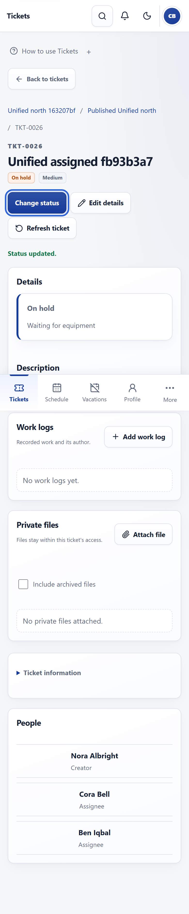

# UI clarity and consolidated tickets implementation 12 October 2026

Status: **`PRODUCTION_RELEASED` for the bounded UI clarity amendment**. All 11 improvements are implemented; 469 unique local cases, static gates and the isolated build pass. Tested application `6e33c6b3ea461c15a53a8af01506d71d4e4ac4f0` is pushed to `origin/main`, Ready and assigned to the [canonical application](https://scopeis-team-management-system.vercel.app/), with 11/11 anonymous live checks. [The sanitized release receipt](evidence/ui-clarity-2026-10-12/production-release.json) records exact source and deployment. Broader Phase 12 and Phase 13 completion are not implied.

## Confirmed experience

**Tickets opens one All accessible list for Super Admin, Admin and Employee.** It combines the actor's current creator, assignee, mentioned/included-observer and independently authorized management access across workspaces and dashboards. Workspace, Dashboard and relationship controls narrow that set. Related tickets are discoverable without entering a container first; unrelated company contents remain protected. Overview and workspace administration remain available as secondary views.

[Current Company ticket decisions](../project-memory/PHASE_12_COMPANY_TICKET_IMPLEMENTATION_DECISIONS.md), [the UI foundation](../project-memory/UI_UX_FOUNDATION.md) and [user journeys](../project-memory/USER_JOURNEYS.md) define the approved behavior. The 9 October review retains its original assessment; this implementation authorization supersedes its review-only boundary and earlier role-specific ticket defaults.

## Approved changes and evidence

| Review item | Implemented behavior | Local verification |
| --- | --- | --- |
| 1 Workspace access | Separate server-derived eligible workspace members from the all-company ticket assignee/mention picker. Existing visible memberships remain revocable even when no longer eligible for a fresh grant. Fresh server role/scope/version checks remain authoritative. | Ticket service negative-permission checks, workspace components and manager desktop/phone journeys pass; the grant-versus-revocation finding was repaired and regression checked. |
| 2 Creation success | Actual success says Ticket created, offers Open ticket and secondary Create another; failed form data and pending double-submission protection remain intact. | Workspace components and creation desktop/phone journeys pass. |
| 3 Phone details | Subject, status and task instructions lead; metadata and People follow or disclose. Visual and reading order agree. | Detail components and desktop/phone journeys pass; screenshots are below. |
| 4 Status action | Focused Change status reuses current work permission, optimistic ticket version, lifecycle checks and On hold reason validation. Edit details stays secondary. | Ticket validation/service checks cover allowed changes, unauthorized and revoked actors, stale versions, concurrent updates and transactional audit/notification rollback; detail components and work journeys pass. |
| 5 Short creation | Destination, work description and people lead. More options contains safe-default optional dates, priority and narratives; required decisions remain visible. | Ticket workspace components and native create-dialog desktop/phone journeys pass. Focused Chrome confirms native modal focus and simulated mobile-keyboard, Escape and focus-restoration behavior. |
| 6 Consolidated relationships | Every role defaults to All accessible across destinations. Assigned to me, Created by me and Mentioned in filters and card labels use minimal authorized server facts. | Ticket service proves authorized cross-workspace consolidation and exclusion of unrelated work; workspace components and every-role desktop/phone journeys pass. |
| 7 Contextual navigation | Clickable Workspace → Dashboard → Ticket breadcrumbs and safe local Back to tickets preserve validated filters/layout; direct links have a fallback. | Navigation/return validation and detail components pass; browser journeys restore relation/destination/layout context. |
| 8 Clear filters | Search/destination remain direct; secondary status/priority filters disclose. Active filters and Clear filters explain normal and empty results across views. | Workspace components and Overview/Tickets/List/Kanban filter-persistence and recovery journeys pass. |
| 9 Daily navigation | Overview is secondary, Employee Home links Tickets, and Schedule/Vacations labels remain consistent. Managers retain every authorized tool. | Navigation, page-journey and reporting components pass; Phase 11 passes eight desktop/phone cases, and ticket journeys verify retained management navigation. Focused Chrome verifies role-specific navigation, RTL, dark theme and doubled text. |
| 10 Compact profile | Recorded skills remain prominent; compact category counts and one Add document or experience chooser retain all five evidence types, review/history states and private files. Saved eligible items guide to Attach file. | Profile/evidence components and Phase 9 pass four desktop/phone cases. Ticket private-file checks pass seven cases and role/access revocation is retained. |
| 11 Vacations | My vacations / Apply for vacation copy and a Monday–Friday/Dubai-year working-day and balance preview preserve current server decisions and role privacy. | Leave preview/year-balance components and Phase 5 pass two desktop/phone cases, including submission and role-specific reading/decision boundaries. |

## Preserved boundaries

Super Admin alone writes, proposes, revises and publishes schedules. Admin retains scoped Draft/Proposed/Published reads and separate cover requests. Employee receives only their own current Published schedule. Vacation submission remains Employee-only; Admin reads approved team unavailability without private reasons/balances, and Super Admin decides requests.

All active company users may create tickets on Published dashboards without workspace enrollment and choose multiple active company assignees/mentions. Creator participant administration, assignee work, read-only notified observers, scoped manager supervision, author-owned work logs, private authorized files, archive/restore history and stale-write refusal remain unchanged. Participation never grants workspace administration or unrelated workforce access.

This UI pass adds no schema, migration, authentication provider, production seed, recurrence, attendance, leave entitlement, automatic publication, daily work, flowchart, cost/PDF, external delivery or future workforce handoff policy. Native keyboard/dialog focus and Escape, 44px phone controls, responsive reflow, logical RTL properties, both themes and reduced motion remain required.

## Validation and release

| Gate | Result |
| --- | --- |
| Final affected source review | Pass. All 11 changes are implemented. Review found that fresh-grant eligibility must not hide retained membership revocation; that path was repaired and regression checked. |
| Unit/component/service/negative-permission checks | Pass: 407 unit/component cases across 58 files, including 26 ticket unit cases. A separate 24 ticket-service and seven ticket-private-file cases pass (31 integration cases); both owned disposable databases were created and dropped with zero retained databases. |
| Desktop/phone authenticated local journeys and visual inspection | Pass for all 14 unique ticket browser case IDs on final source: the full third attempt passed 13/14, then the remaining case passed alone in 15.1 seconds. Phase 5 passes 2/2, Phase 9 4/4 and Phase 11 8/8; guarded runners clean up their owned disposable databases. Screenshots below use fictional data. |
| Focused Chrome presentation gate | Pass 3/3, exit 0, on Google Chrome `154.0.8037.98`; the owned disposable database was cleaned up. Finite motion/modal focus passes in 10.2 seconds, role-specific navigation/RTL/dark theme/200% text in 32.1 seconds, and simulated mobile-keyboard/native-dialog/Escape/focus restoration in 2.2 seconds. |
| Types, lint, scenario manifest and whitespace | Pass: full TypeScript and ESLint, 84 registered scenarios (83 automated and one manual), 92 registered tests, 39 protected routes and whitespace validation. |
| Isolated final-source production build | Pass: production-safe isolated Next.js build/source checks and types. Local/production environment files are excluded from the isolated build. |
| Commit and `origin/main` push | Pass: tested application `6e33c6b3ea461c15a53a8af01506d71d4e4ac4f0` is pushed to `origin/main`; clean `main` sync was verified 0 ahead / 0 behind. |
| Exact-source Ready deployment and canonical alias | Pass at `2026-10-12T06:04:41.050Z`: `dpl_HCQ7qtLb1F4ZL82RF3B3AdkGMKiA` is `READY` for exact application source in project `prj_JvFv2V2vKKmAqfBOySS8FsZ1aZjy`. Deployment [scopeis-team-management-system-hffwxc2ss-mu-ka7.vercel.app](https://scopeis-team-management-system-hffwxc2ss-mu-ka7.vercel.app) holds the canonical `scopeis-team-management-system.vercel.app` alias. |
| Anonymous live public-access smoke | Pass 11/11, exit 0, at `2026-10-12T06:04:57.037Z`: sign-in page 200; Schedule/Tickets/Home/Profile redirect 307 to sign-in; ticket list/detail/file reads and command/file writes refuse 401 with private/no-store/no-sniff headers; production mock-login POST refuses 404. |
| Authenticated production roles/private files | Not certified by local or anonymous evidence; requires normal production credentials. |

The local totals above comprise **469 unique automated cases**: 407 unit/component, 31 integration, 28 desktop/phone journey cases across Tickets, Vacations, Profile/evidence and reporting, and three focused Chrome presentation cases. The 26 ticket unit cases are included in 407 rather than counted twice. Raw runner receipts, including failed attempts, the final `unit-component-results.json` and `responsive-focused-chrome.json`, remain in ignored private evidence. Historical receipts apply only to their own source.

The focused presentation evidence runs three existing [responsive scenario cases](../../test/e2e/responsive.spec.ts): **motion stays finite, preserves modal focus and works across desktop and phone**; **role navigation, RTL, dark theme and enlarged text reflow**; and **task dialogs keep fields and actions above a simulated mobile keyboard**. It verifies these named cases on the final source after correcting the Chrome executable path, readiness timeout and atomic dismissal observation; the final complete focused invocation is green. It is bounded Chrome evidence, not physical-device or cross-browser certification.

### Repaired attempts and verification limits

Earlier ticket-browser attempts used selectors that assumed previously expanded sections. Those test selectors were updated for the implemented disclosures; the red receipts remain retained. The third full ticket run's remaining failure was a 30-second Super Admin sign-in timeout under concurrent load, followed by the same isolated final-source case passing in 15.1 seconds. This verifies every unique case ID but is not a claim that the entire ticket suite passed in a single final invocation.

The separate broad 14-check responsive suite is **not certified** for this source. An initial hardcoded Google Chrome path failure executed no UI checks; a subsequent Chromium run encountered transient locator timing, the broad-sweep timeout and the run's 900-second budget. The subsequent focused Google Chrome 154 gate passes 3/3 after the harness corrections above. Those three checks do not substitute for a complete broad responsive suite or a full system lock. Local authenticated checks and the completed anonymous production smoke do not certify authenticated production role/private-file journeys without ordinary credentials.

## Production delivery scope

The [release receipt](evidence/ui-clarity-2026-10-12/production-release.json) certifies the tested application commit and its actual Ready/canonical deployment, plus anonymous public-access refusals. It contains no credentials, environment values, local absolute paths or company user data. No migration, production database write/seed, environment/credential or provider change occurred. The source-only UI/service changes preserve the established production configuration and stored facts.

This documentation closure may produce a later commit; any deployment for that later source requires its own verification. It must not be inferred from application `6e33c6b3ea461c15a53a8af01506d71d4e4ac4f0`'s Ready receipt. Phase 12 remains `PARTIAL`, general Phase 13 readiness is not certified, and the independent retained-history schedule-removal finding remains open.

## Local visual evidence

The following final-source screenshots show fictional local data. The consolidated-ticket screenshots retain an existing **Kanban** presentation; they demonstrate the All accessible ticket set and persistent layout, not a fresh-session default List screenshot.

- [Desktop consolidated tickets](evidence/ui-clarity-2026-10-12/desktop-all-accessible-tickets.png)
- [Phone consolidated tickets](evidence/ui-clarity-2026-10-12/mobile-all-accessible-tickets.png)
- [Desktop ticket details](evidence/ui-clarity-2026-10-12/desktop-ticket-detail.png)
- [Phone ticket details](evidence/ui-clarity-2026-10-12/mobile-ticket-detail.png)

